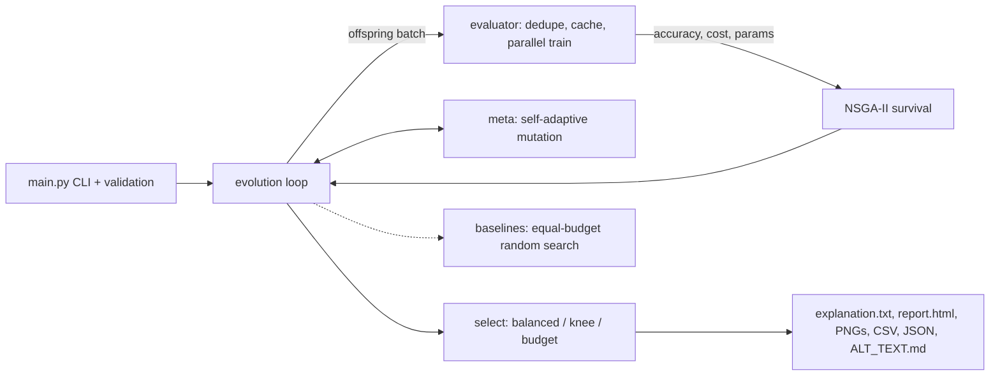

# AutoMind-X

**Self-adaptive, explainable neural architecture search (NSGA-II Pareto search over MLPs) - pure Python.**

AutoMind-X evolves small neural networks and trades off **accuracy, training cost and model size at the
same time**, adapts its own mutation rate while it runs, and finishes with a plain-language report that
explains *why* the winning architecture was chosen. Supports **SDG 9 (Industry, Innovation and
Infrastructure), target 9.4**: resource-efficient computation and automation.

## Contents

1. [Problem statement](#problem-statement)
2. [SDG 9 alignment](#sdg-9-alignment)
3. [Quick start](#quick-start)
4. [Command-line options](#command-line-options)
5. [Results (measured)](#results-measured)
6. [Architecture](#architecture)
7. [How the objectives and self-adaptation work](#how-the-objectives-and-self-adaptation-work)
8. [Configuration and environment variables](#configuration-and-environment-variables)
9. [Project layout](#project-layout)
10. [Testing and quality](#testing-and-quality)
11. [Known limitations](#known-limitations)
12. [More documentation](#more-documentation)

## Problem statement

Choosing a neural-network architecture is a trade-off between accuracy, training cost and model size,
yet AutoML tools usually return one opaque "best" model. AutoMind-X searches the architecture space with
**NSGA-II Pareto search** over MLPs, with **self-adaptive mutation** and a **deterministic cost estimate**
for reproducibility. The final model is chosen by **weighted score, knee point, or a deployment budget**,
and comes with a **plain-language explanation**. On a **held-out test set** the chosen model is about
**12x smaller** and **32x cheaper to train** than a default MLP, at roughly **2 points lower accuracy**.
Against an **equal-budget random search** it finds a significantly better Pareto front (hypervolume) at
the default budget, but not a significantly better single best model - see [Results](#results-measured).

## SDG 9 alignment

Target **9.4** asks for resource-efficient, sustainable industry and infrastructure. AutoMind-X turns the
accuracy/cost/size trade-off into an explicit choice, so an engineer can pick the smallest model that
meets a real budget (`--max-params`, `--max-cost`) instead of defaulting to an oversized one. Measured
effect on the benchmark: **12.3x fewer parameters, about 32x lower estimated training cost, 2 points less
accuracy**; the search itself avoids waste (duplicates trained once, `--cache` makes repeats ~80x faster).
Details, evidence and honest limits: [docs/SDG9_IMPACT.md](docs/SDG9_IMPACT.md).

## Quick start

```bash
pip install -r requirements.txt
python main.py --quick                       # ~5-10 s demo
python main.py                               # full run: 4 graphs + report + CSV in outputs/
python main.py --select knee --json          # weight-free "best compromise" + summary.json
python main.py --quick --compare-random 5    # equal-budget comparison with random search
python main.py --quick --profile             # where does the time go? -> outputs/profile.txt
python main.py --cache .cache/m.json         # repeat runs skip retraining
python main.py --help                        # every option
```

Developers: `pip install -r requirements-dev.txt && make check` (lint, types, security, docstrings, tests).
Docker: `docker build -t automind-x . && docker run --rm automind-x`.
Library use and examples: [docs/USAGE.md](docs/USAGE.md), [`examples/`](examples).

## Command-line options

| Option | Meaning |
|---|---|
| `--quick` | small fast demo |
| `--generations N`, `--pop N`, `--seed N` | search size and reproducibility |
| `--runtime-metric {proxy,wallclock}` | `proxy` (default) = deterministic FLOPs-based cost, fully reproducible; `wallclock` = measured seconds |
| `--select {balanced,knee}` | final choice: weighted fitness, or the knee point (closest to the ideal point, no weights) |
| `--max-params N`, `--max-cost X` | deployment budget: the chosen model must fit; the report says whether it was satisfiable |
| `--n-jobs N` | parallel training of each generation's offspring (`-1` = all cores, `1` = serial) |
| `--compare-random SEEDS` | also run equal-budget random search over SEEDS seeds; report paired difference + 95% CI |
| `--cache FILE` | persist measurements (proxy metric) so identical repeat runs train nothing |
| `--profile` | write a cProfile summary to `<outdir>/profile.txt` |
| `--outdir DIR` | output directory (default `$AUTOMIND_OUTDIR` or `outputs`) |
| `--json`, `--no-plots`, `--quiet` | machine-readable summary, skip figures, silence progress |

Exit codes: `0` success, `2` invalid input.

## Results (measured)

Full tables, method and caveats: [docs/EVALUATION.md](docs/EVALUATION.md).

| Held-out test (seed 42) | AutoMind-X | Default MLP(100) | Ratio |
|---|---|---|---|
| Parameters | 195 | 2403 | 12.3x smaller |
| Estimated training cost | 33 ms | 1060 ms | 31.8x cheaper |
| Test accuracy | 0.794 | 0.814 | -0.020 |

| vs random search, equal budget (182 trainings, 8 seeds) | Mean difference | 95% CI | W/T/L |
|---|---|---|---|
| Hypervolume (Pareto front quality) | **+0.0163** | [+0.0027, +0.0325] | 6/0/2 |
| Best accuracy | +0.0043 | [-0.0015, +0.0103] | 6/0/2 |

The advantage is on **front quality**, it is modest, and it is **not** significant for the single best
model or at very small budgets. Efficiency: training is 99.7% of run time; warm cache ~80x faster;
vectorised dominance sort 2x faster. Compact-model inference latency is *not* lower than the default
MLP's on this CPU (framework overhead) - reported in the docs rather than hidden.

## Architecture



*Text description:* the CLI builds a validated configuration; the evolution loop has the evaluator
train each generation's offspring (deduplicated, cached, parallel); NSGA-II selects survivors; a meta
controller adapts mutation; a selection step picks the final model and writes the reports; an optional
baseline module runs random search with the same budget. Deeper explanation:
[docs/ARCHITECTURE.md](docs/ARCHITECTURE.md).

### Pseudocode
```
pop = random genomes; evaluate; NSGA-II rank + crowding
meta.update(best fitness)
repeat for each generation:
    offspring = []
    while |offspring| < N:
        p1, p2 = tournament(pop), tournament(pop)          # SELECTION (rank, then crowding)
        child  = crossover(p1, p2)  or  copy(p1)           # CROSSOVER
        child.rate = child.rate * exp(tau * N(0,1))        # META (individual): evolve own rate
        rate = clip(child.rate * meta.multiplier)          # META (population): global multiplier
        mutate(child, rate)                                # MUTATION: resize/add/remove/activation/lr
        evaluate(child)                                    # FITNESS: acc, runtime, params
    pool = unique(pop + offspring)
    pop  = NSGA-II survival(pool, N)  (+ keep the best-fitness champion)
    if best fitness improved: multiplier *= 0.85   (exploit)
    else:                     multiplier *= 1.25   (explore)
final = best member of Pareto front 0 by balanced fitness, knee point, or within the budget
explain(final)  ->  vs alternatives, vs earlier generations, lineage, what the search learned
```

## How the objectives and self-adaptation work

* **Selection uses Pareto dominance** (error, runtime, params all minimised) - no hand-tuned weights during search.
* **Scalar fitness** `0.6*acc - 0.2*time/time_ref - 0.2*params/params_ref` is used only to (a) sense improvement for the
  mutation controller, (b) plot the fitness graph, (c) pick ONE model from the final Pareto front.
* **Meta-evolution** has two levels: each genome carries and evolves its own mutation rate; a population
  multiplier goes up when progress stalls and down when it improves.

## Configuration and environment variables

Precedence: **CLI flag > `AUTOMIND_*` environment variable > default.** Copy [`.env.example`](.env.example)
to `.env` (git-ignored) to document and set the variables. The project needs **no API keys or secrets**.
Programmatic: `Config(pop_size=20)` or `Config.from_env()`; invalid values fail fast with a clear message.

## Project layout

```
automind_x/
├── main.py                 CLI entry point
├── automind/
│   ├── config.py           every hyper-parameter, validated; Config.from_env()
│   ├── genome.py           Genome = layers + activation + lr + its OWN mutation-rate gene
│   ├── dataset.py          synthetic data, stratified train/val/test split
│   ├── evaluator.py        train (batched, parallel, cached) -> accuracy, cost, params; hold-out; latency
│   ├── pareto.py           dominance, non-dominated sort, crowding, NSGA-II survival, hypervolume
│   ├── operators.py        tournament selection, crossover, 5 mutation operators
│   ├── meta.py             self-adaptive mutation + meta-evolution controller
│   ├── evolution.py        the evolution loop
│   ├── baselines.py        equal-budget random search + paired multi-seed comparison
│   ├── explain.py          final selection + "why was this selected?" report
│   ├── report.py           accessible HTML report
│   └── visualize.py        convergence / fitness / accuracy-vs-cost / Pareto plots
├── tests/                  unit, property-based, determinism, CLI, end-to-end (85 tests)
├── benchmarks/             bench.py, RESULTS.md, random_search_comparison.txt
├── examples/               quickstart.py, budgeted_edge_model.py
├── docs/                   ARCHITECTURE, USAGE, API, EVALUATION, SDG9_IMPACT, FAQ
├── outputs/                generated figures, report, CSV, JSON, profile
└── .env.example, pyproject.toml, Makefile, Dockerfile, CI, LICENSE, SECURITY.md, CONTRIBUTING.md, CODE_OF_CONDUCT.md
```

## Testing and quality

| Layer | What is checked |
|---|---|
| Unit | dominance, sorting, crowding, survival, hypervolume (analytic value 0.125 for point (.5,.5,.5)) |
| Property | 300 random crossover+mutation runs always yield valid genomes |
| Correctness | analytic `count_params` == sklearn's real weight count; vectorised sort == naive definition |
| Behaviour | fitness ordering; cache hit; meta multiplier rises on stagnation, falls on improvement, stays bounded |
| Integration | tiny end-to-end run: history, elitism, report generated |
| Reproducibility | same seed -> identical whole run; disk-cache warm run identical to cold run |
| Baselines | random search uses the exact same budget; comparison statistics, verdict wording |
| Robustness | invalid config / env / CLI args rejected; parallel == serial; corrupt cache ignored |
| Outputs | CLI end-to-end writes report, CSV, JSON, profile, PNGs, alt text |

`make check` = ruff + mypy + bandit + docstring gate (100%) + tests (85, 99% coverage). CI runs the same on
Python 3.10-3.12, plus `pip-audit` and a secret scan.

## Known limitations

* Synthetic tabular data and a plain MLP search space; other domains are not claimed.
* The default runtime objective is a FLOPs *proxy* (reproducible, hardware independent), not measured time;
  use `--runtime-metric wallclock` for real timings (serial, not bit-reproducible).
* The advantage over random search is on Pareto-front quality only, modest, and needs a large enough budget.
* Compact models do not have lower single-sample inference latency with scikit-learn on CPU.
* Parallel speed-up depends on core count (`benchmarks/bench.py` reports your numbers).
* Same loop works with PyTorch models by swapping `_fit_model` / `_train_and_score` in `evaluator.py`.

## More documentation

[Usage](docs/USAGE.md) · [Architecture](docs/ARCHITECTURE.md) · [Evaluation](docs/EVALUATION.md) ·
[SDG 9 impact](docs/SDG9_IMPACT.md) · [FAQ](docs/FAQ.md) · [Changelog](CHANGELOG.md) ·
[Contributing](CONTRIBUTING.md) · [Security](SECURITY.md)
