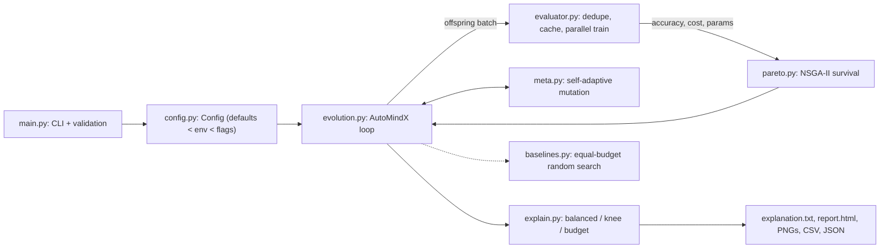

# Architecture

AutoMind-X is a small, dependency-light (NumPy, scikit-learn, matplotlib, joblib) neural architecture
search. This page explains how the parts fit together and why each design choice was made.

## Data flow

*Text description of the diagram:* the command-line entry point builds a validated `Config`. The
evolution loop asks the evaluator to train each generation's offspring (duplicates are removed, results
are cached, training runs in parallel). NSGA-II keeps the survivors. A meta-controller adapts the
mutation rate. At the end a selection step picks one model and writes the reports. A separate baseline
module can run random search with the same training budget for comparison.

## Modules

| Module | Responsibility |
|---|---|
| `config.py` | Every hyper-parameter, validated on creation; `Config.from_env()` reads `AUTOMIND_*` variables |
| `genome.py` | A candidate network (layers, activation, learning rate) plus its own mutation-rate gene |
| `dataset.py` | Synthetic classification data, stratified 60/20/20 split, scaler fit on train only |
| `evaluator.py` | Trains networks, measures accuracy / cost / parameters, caches (memory and optional disk), measures inference latency |
| `pareto.py` | Dominance, non-dominated sort, crowding distance, NSGA-II survival, hypervolume |
| `operators.py` | Tournament selection, crossover, five mutation operators |
| `meta.py` | Two-level self-adaptive mutation (per-genome gene + population multiplier) |
| `evolution.py` | The generation loop, statistics history, lineage registry |
| `explain.py` | Final selection (balanced / knee / budget) and the plain-language explanation |
| `baselines.py` | Random search with an identical budget, paired multi-seed comparison |
| `report.py`, `visualize.py` | Accessible HTML report, colour-blind-safe figures, alt text |

## Design decisions

1. **Three objectives, no weights during search.** Error, training cost and parameter count are
   minimised together with NSGA-II. A weighted score exists only to (a) sense improvement for the
   mutation controller and (b) pick one model at the end.
2. **Deterministic cost proxy.** Wall-clock time is noisy and hardware dependent. The default cost is a
   FLOPs estimate (`6 x params x samples x epochs / flops_per_s`), so the same seed always gives the
   same search. Wall-clock is still recorded and selectable.
3. **Honest evaluation.** The search sees only the validation split. The final model is retrained and
   scored on an untouched test split and compared with a default MLP.
4. **Efficiency by construction.** Identical architectures are trained once (memoised), each generation
   is trained as one parallel batch, and dominance is computed with one vectorised NumPy pass.
   Profiling shows training is over 95% of run time, so avoiding retraining (cache) is the biggest lever.
5. **Explainability as a feature.** Every genome records how it was created, so the report can show
   lineage, trade-offs against alternatives and what the search learned.

## Extending

* **New gene** (e.g. dropout): add a field to `Genome`, a value list to `Config`, and an operator in
  `operators.OPS`.
* **Another framework**: replace `_fit_model` / `_train_and_score` in `evaluator.py`; everything else
  only sees `(accuracy, runtime, params)`.
* **New objective**: append it in `Genome.objectives()` and `normalised_objectives()`.
